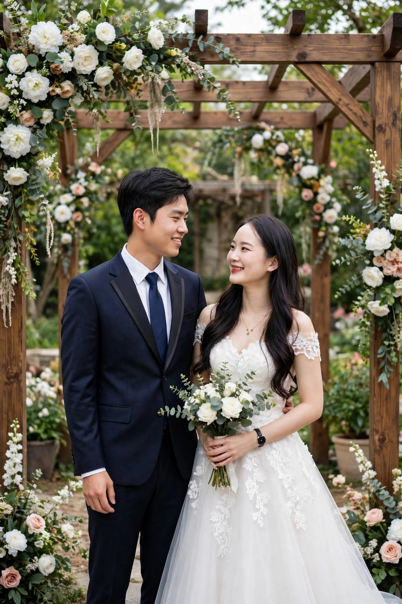

# Website Thiệp Cưới - Văn Lưu & Thu Hương

Website thiệp mời cưới (HTML/CSS/JS thuần), làm từ mẫu thiệp Tiến Độ & Lâm Oanh.

## 📅 Thông tin sự kiện

**Lễ Thành Hôn — Thứ Sáu, 11h00, 20.11.2026**
(Tức Ngày 12 Tháng 10 Năm Bính Ngọ)
Gia đình nhà trai — Liên Sơn, Phường Hoành Sơn, Thị xã Kỳ Anh, Hà Tĩnh

**Tiệc mời cỗ — Thứ Năm, 19.11.2026**
(Tức Ngày 11 Tháng 10 Năm Bính Ngọ)

| | Nhà Trai (`index.html`) | Nhà Gái (`nhagai.html`) |
|---|---|---|
| Giờ | 17h00 | 16h00 |
| Địa điểm | Liên Sơn - Phường Hoành Sơn, Thị xã Kỳ Anh, Hà Tĩnh | Liên Giang - Phường Vũng Áng, Thị xã Kỳ Anh, Hà Tĩnh |

> Giờ lễ (11h00) và giờ tiệc (17h00/16h00) đang giữ theo mẫu cũ — báo giờ thật để sửa nếu khác.
> Nút bản đồ đang dẫn bằng địa chỉ chữ (chưa có tọa độ nhà chính xác) — gửi link vị trí nhà từ Google Maps để ghim đúng nhà.

## 📁 Cấu trúc

```
├── index.html          # Trang NHÀ TRAI
├── nhagai.html         # Trang NHÀ GÁI
├── style.css / style2.css
├── js.js               # Animation khi cuộn trang
├── invite.js           # Căn đường kẻ thiệp + xem ảnh phóng to
├── source/
│   ├── chure.jpg       # Ảnh chú rể Văn Lưu
│   ├── codau.jpg       # Ảnh cô dâu Thu Hương
│   ├── meta.jpg        # Ảnh preview khi share link
│   ├── album/01.jpg    # Chú rể
│   ├── album/02.jpg    # Cô dâu
│   ├── doc/            # Nền thiệp + 3 ảnh phần "Thư mời"
│   ├── music.mp3       # Nhạc nền
│   └── favicon.png
└── README.md
```

## 🌐 Đẩy lên GitHub Pages

1. Tạo repo mới trên GitHub (ví dụ `thiep-vanluu-thuhuong`), **không** tick README.
2. Trong thư mục này:
   ```bash
   git init
   git add -A
   git commit -m "Thiệp cưới Văn Lưu & Thu Hương"
   git branch -M main
   git remote add origin https://github.com/<tên-bạn>/thiep-vanluu-thuhuong.git
   git push -u origin main
   ```
3. Vào repo → **Settings** → **Pages** → Source: **Deploy from a branch** → Branch **main**, thư mục **/ (root)** → **Save**. Đợi 1-2 phút là có link.
4. Link gửi khách:
   - Nhà trai: `https://<tên-bạn>.github.io/thiep-vanluu-thuhuong/`
   - Nhà gái: `https://<tên-bạn>.github.io/thiep-vanluu-thuhuong/nhagai.html`

Sau khi có link, sửa 2 dòng `og:image` và `og:url` trong `<head>` của cả hai file
thành link tuyệt đối (đang để tương đối) để ảnh preview hiện đẹp khi share.

## 🖼️ Thêm ảnh vào album

1. Nén ảnh về tối đa 1600px:
   ```bash
   ffmpeg -i anh-moi.jpg -vf "scale='if(gt(iw,ih),min(1600,iw),-2)':'if(gt(iw,ih),-2,min(1600,ih))'" -q:v 4 source/album/03.jpg
   ```
2. Thêm 1 dòng vào `album_container` trong cả hai file:
   ```html
   
   ```
   Số đếm lightbox tự cập nhật, không cần sửa gì thêm.

## 📝 Chưa có nên đã gỡ tạm

- Nút **Xác nhận tham dự**: form Google cũ là của cặp đôi trước. Tạo 2 form mới
  rồi gửi link là mình gắn lại nút cho cả hai trang.
- Nút **Gửi quà mừng** (QR/STK): chưa có số tài khoản của Văn Lưu & Thu Hương.
  Gửi STK + ảnh QR là mình thêm lại.

## 🚀 Chạy thử ở máy

```bash
python -m http.server 8000
```

Mở http://localhost:8000 (nhà trai) và http://localhost:8000/nhagai.html (nhà gái).
